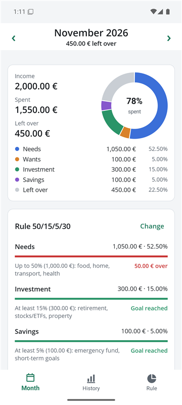
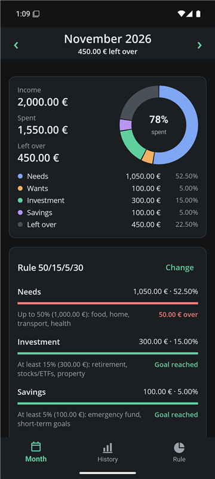
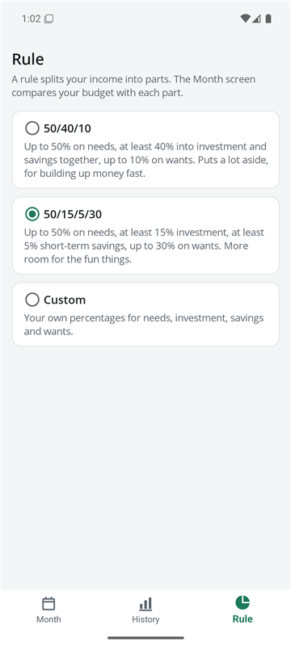
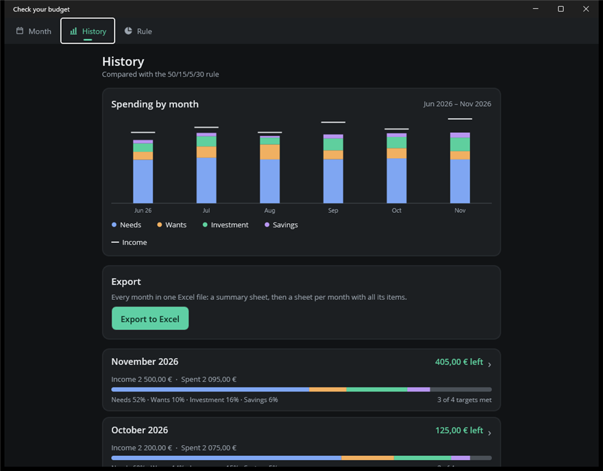

# Check your budget

A simple budget app for Android and Windows. Enter what you earn and what you spend each month. The app shows where the money goes and how it compares to a budgeting rule such as 50/40/10.

<p>
  
  
  
</p>

## What it does

- **One budget per month.** Add, rename and remove your own items under Income, Needs, Wants, Investment and Savings. A new month starts as a copy of the last one, so you only change what's different.
- **A rule to compare with.** Pick 50/40/10, 50/15/5/30, or your own percentages. Each part of the rule shows how much you've used and how much is left (or over).
- **History.** A chart of spending by month next to your income, and every month you've filled in, so you can see how you're doing over time.
- **Excel export.** All months in one `.xlsx` file: a summary sheet, then a sheet per month with every item. On Android it opens the share menu (Drive, Gmail and so on). On Windows it saves to Documents.
- **Private.** The Android app asks for no permissions, not even internet access. Your budget stays on your device. The only copy elsewhere is in Android's own backup, if you've turned that on.



## Install

**Android:** download the `.apk` from the latest [release](https://github.com/JokerPSYF/Check-your-budget/releases) and open it on your phone. Android asks you once to allow installing apps from your browser or file manager. Android 7.0 or newer is needed.

**Windows:** build it from source, as described below. If you used the earlier Windows version, its saved budget is picked up automatically as the current month.

## Build from source

You need the [.NET 10 SDK](https://dotnet.microsoft.com/download) and the MAUI workloads:

```
dotnet workload install maui-android maui-windows
```

Then, from the `CheckYourBudget` folder:

| To | Run |
| --- | --- |
| Run the tests | `dotnet test CheckYourBudget.Core.Tests` |
| Start the Windows app | `dotnet build CheckYourBudget.App -t:Run -f net10.0-windows10.0.19041.0` |
| Build the Android `.apk` | `dotnet publish CheckYourBudget.App -f net10.0-android -c Release` |

The Android build also needs the Android SDK. Visual Studio installs it, or you can run `dotnet build CheckYourBudget.App -t:InstallAndroidDependencies -f net10.0-android -p:AcceptAndroidSDKLicenses=True`.

## How it's built

| Project | What's in it |
| --- | --- |
| `CheckYourBudget.Core` | The calculations, the rules, months, saving and loading, and the Excel export. Plain .NET with no UI, so it can be tested on its own. |
| `CheckYourBudget.Core.Tests` | MSTest tests for everything in Core. |
| `CheckYourBudget.App` | The .NET MAUI app: one set of screens for Android and Windows. |

The budget is saved as `budget-book.json`: in the app's private storage on Android, and in `%APPDATA%\CheckYourBudget` on Windows. A save never leaves a half-written file. If the file can't be read, it's set aside with its date in the name instead of being overwritten.

Every push to `main` runs the tests and builds the Android app on GitHub Actions. Pushing a tag such as `v1.0` also publishes a release with the signed `.apk`.

## License

[Apache 2.0](LICENSE)
